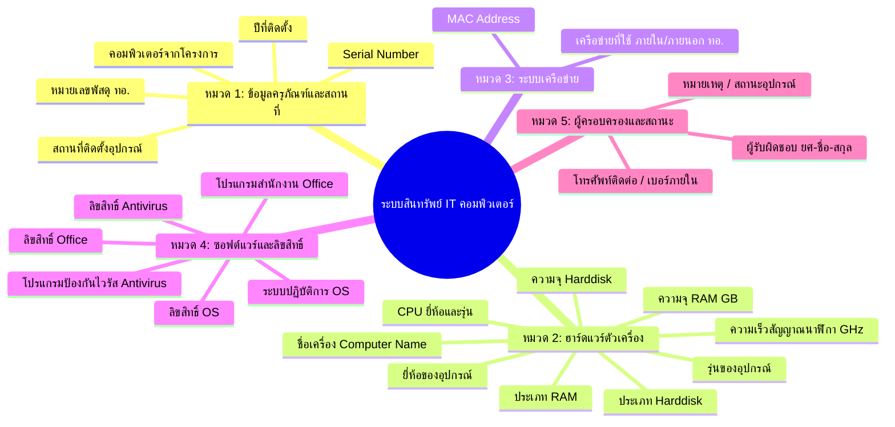

# การออกแบบระบบบริหารจัดการสินทรัพย์ IT (IT Asset Management System)
> ออกแบบเฉพาะสำหรับสินทรัพย์คอมพิวเตอร์และอุปกรณ์ต่อพ่วง อิงตามแบบฟอร์มบันทึกข้อมูลสินทรัพย์ ทอ. (26 ฟิลด์)

---

## 1. แนวคิดและโครงสร้างการจัดหมวดหมู่ข้อมูล (Data Categorization)

เพื่อให้การบันทึกข้อมูลไม่ซับซ้อนและผู้ใช้งานสามารถกรอกหรือค้นหาได้สะดวกรวดเร็ว จึงจัดกลุ่มฟิลด์ข้อมูลทั้ง 26 รายการออกเป็น **5 หมวดหมู่หลัก (Logical Groups)**:

---

## 2. รายละเอียดฟิลด์ข้อมูลและค่าเริ่มต้นตัวเลือก (Preset Dropdown & Free-text)

ระบบออกแบบเป็น **Combobox (Editable Dropdown)** กล่าวคือ **มีลิสต์รายการยอดนิยมให้คลิกเลือกทันที** แต่หากเครื่องมีสเปกเฉพาะก็สามารถ **พิมพ์ค่าใหม่ลงไปได้ทันที**

| ลำดับ | ชื่อฟิลด์ (Field Name) | ประเภทข้อมูล | ตัวเลือกเริ่มต้นใน Dropdown (Presets) | ความสำคัญ |
|:---:|:---|:---:|:---|:---:|
| 1 | **ลำดับ (No.)** | Auto Number | ระบบสร้างให้อัตโนมัติ (1, 2, 3...) | จำเป็น |
| 2 | **สถานที่ติดตั้งอุปกรณ์** | Combobox | **หน่วยงานใน กองบิน 23 (บน.23) รวม 31 หน่วย:** - ผธก.บก.บน.23 - ผกพ.บก.บน.23 - ผขว.บก.บน.23 - ผยก.บก.บน.23 - ผกบ.บก.บน.23 - ผกร.บก.บน.23 - มว.จัดหา บก.บน.23 - นงป.บน.23 - นธน.บน.23 - นิรภัย บน.23 - อศจ.บน.23 - ผกง.บน.23 - ฝูง.231 บน.23 - พัน.อย.บน.23 - ผนบ.บน.23 - บก.กทน.บน.23 - ผชอ.กทน.บน.23 - ผสอ.กทน.บน.23 - ผสพ.กทน.บน.23 - มว.บชพ.กทน.บน.23 - รพ.กองบิน บน.23 - ผชย.บน.23 - ผขส.บน.23 - ผพธ.บน.23 - ผสก.บน.23 - ร้อย.ทสห.บน.23 - ฝคก.บน.23 - ฝูง.236 (สกลนคร) - ฝูง.238 (นครพนม) - ฝคส.2 (แอมโม่) - หน่วยบิน 2038 *(หรือพิมพ์ห้อง/จุดติดตั้งเพิ่มเติมเองได้)* | จำเป็น |
| 3 | **ชื่อเครื่องคอมพิวเตอร์** | Text / Generator | แนะนำรูปแบบ: `[หน่วยงาน]-[ประเภท]-[ลำดับ]` เช่น `RTAF-HQ-PC01`, `COMM-DESK-015`, `FIN-NB-008` | จำเป็น |
| 4 | **หมายเลขพัสดุ ทอ.** | Text | รูปแบบมาตรฐาน: `ทอ.7110-001-XXXX/66`, `ทอ.7025-002-XXXX/67` | จำเป็น |
| 5 | **Serial number (S/N)** | Text | บาร์โค้ด / Serial number จากโรงงานผู้ผลิต | จำเป็น |
| 6 | **ยี่ห้อของอุปกรณ์** | Combobox | - Dell - HP - Lenovo - Acer - ASUS - Apple - Fujitsu - ประกอบเอง (Custom PC) | จำเป็น |
| 7 | **รุ่นของอุปกรณ์** | Combobox | - Dell OptiPlex 7010 / 5090 / 3080 - HP ProDesk 400 G7 / EliteDesk 800 G6 - Lenovo ThinkCentre M70q / M720s - Acer Veriton M Series - ASUS ExpertCenter D500 - HP ProBook / EliteBook (Laptop) - Dell Latitude / Vostro (Laptop) | แนะนำ |
| 8 | **ยี่ห้อ และรุ่น CPU** | Combobox | - Intel Core i3-12100 - Intel Core i5-10400 / 11400 / 12400 / 13400 - Intel Core i7-11700 / 12700 / 13700 - AMD Ryzen 5 5600G / 7600 - AMD Ryzen 7 5700G / 7700 - Apple M1 / M2 / M3 | จำเป็น |
| 9 | **ความเร็วสัญญาณนาฬิกา (GHz)** | Combobox | - 2.00 GHz - 2.50 GHz - 2.90 GHz - 3.20 GHz - 3.60 GHz - 3.90 GHz - 4.20 GHz | เสริม |
| 10 | **MAC Address** | Text (Regex) | รูปแบบ `XX:XX:XX:XX:XX:XX` หรือ `XX-XX-XX-XX-XX-XX` | จำเป็น |
| 11 | **เครือข่ายที่ใช้** | Combobox | - เครือข่ายภายใน ทอ. (AirNet / RTAF Intranet) - เครือข่ายภายนอก ทอ. (Internet สาธารณะ) - ใช้งาน 2 ระบบ (Dual Network Card) - Standalone (ไม่เชื่อมต่อเครือข่าย / Air-gapped) | จำเป็น |
| 12 | **ประเภทของ RAM** | Combobox | - DDR5 - DDR4 - DDR3 - LPDDR5 (On-board) - LPDDR4x | แนะนำ |
| 13 | **ความจุของ RAM (GB)** | Combobox | - 8 GB - 16 GB - 32 GB - 64 GB - 4 GB (รุ่นเก่า) | จำเป็น |
| 14 | **ประเภท Harddisk** | Combobox | - M.2 NVMe PCIe SSD - 2.5" SATA SSD - 3.5" SATA HDD (7200 RPM) - M.2 SSD + SATA HDD (ไดรฟ์คู่) | จำเป็น |
| 15 | **ความจุของ Harddisk** | Combobox | - 256 GB SSD - 512 GB SSD - 1 TB SSD - 1 TB HDD - 256 GB SSD + 1 TB HDD - 512 GB SSD + 1 TB HDD | จำเป็น |
| 16 | **ชื่อระบบปฏิบัติการ (OS)** | Combobox | - Windows 11 Pro 64-bit - Windows 10 Pro 64-bit - Windows 11 Home 64-bit - Windows 10 Enterprise - Ubuntu Linux Desktop 22.04 LTS / 24.04 LTS - macOS Sonoma / Sequoia | จำเป็น |
| 17 | **ลิขสิทธิ์ของระบบปฏิบัติการ** | Combobox | - OEM (ติดสติกเกอร์มาพร้อมเครื่อง) - Volume License (KMS / MAK ประจำ ทอ.) - FPP (Full Packaged Product - กล่อง) - Open Source / GNU General Public License | จำเป็น |
| 18 | **ชื่อโปรแกรมสำนักงาน** | Combobox | - Microsoft Office 2021 Professional Plus - Microsoft Office 2019 Professional - Microsoft 365 Apps for Enterprise - LibreOffice 7.x / 24.x - WPS Office - OpenOffice - ไม่ได้ติดตั้ง | จำเป็น |
| 19 | **ลิขสิทธิ์ของโปรแกรมสำนักงาน** | Combobox | - Volume License (สัญญาลิขสิทธิ์ ทอ.) - Retail / FPP - Subscription (รายปี M365) - Open Source / ฟรีแวร์ - ไม่มีลิขสิทธิ์ / ทดลองใช้งาน | จำเป็น |
| 20 | **ชื่อโปรแกรมป้องกันไวรัส** | Combobox | - Windows Defender / Microsoft Defender - Trend Micro Apex One - Kaspersky Endpoint Security - ESET Endpoint Security - Symantec Endpoint Protection - Bitdefender GravityZone - ไม่ได้ติดตั้ง | จำเป็น |
| 21 | **ลิขสิทธิ์โปรแกรมป้องกันไวรัส** | Combobox | - Enterprise Centralized License (ทอ.) - Standalone License (รายเครื่อง) - ฟรีไลเซนส์ / ติดมากับระบบปฏิบัติการ - หมดอายุการคุ้มครอง | แนะนำ |
| 22 | **คอมพิวเตอร์จากโครงการ** | Combobox | - โครงการจัดหาระบบคอมพิวเตอร์เพื่อการพัฒนางาน ทอ. ปี 65 - โครงการจัดซื้อทดแทนเครื่องคอมพิวเตอร์หมดอายุ ปี 66 - โครงการเสริมสร้างขีดความสามารถด้านสารสนเทศ ทอ. ปี 67 - โครงการศูนย์ปฏิบัติการไซเบอร์ ทอ. - งบประมาณดำเนินงานปกติของหน่วย - ได้รับโอนกรรมสิทธิ์จากหน่วยงานอื่น | แนะนำ |
| 23 | **ปีที่ติดตั้ง** | Combobox | ปี พ.ศ. ครอบคลุม **2550 ถึง 2580** (เช่น 2568, 2567, 2566, 2565...) | จำเป็น |
| 24 | **ผู้รับผิดชอบ** | Combobox / Text | ยศ - ชื่อ - นามสกุล (เช่น น.ต.สมชาย รักชาติ, ร.ท.หญิงกมลวรรณ ทวีทรัพย์) | จำเป็น |
| 25 | **โทรศัพท์ติดต่อผู้รับผิดชอบ** | Text | เบอร์โทรศัพท์มือถือ หรือเบอร์โทรศัพท์ภายใน ทอ. (เช่น `081-234-5678`, `2-4567`) | จำเป็น |
| 26 | **หมายเหตุ** | Combobox / Text | - สภาพพร้อมใช้งานปกติ - อยู่ระหว่างส่งซ่อมภายนอก - อยู่ระหว่างรออะไหล่ทดแทน - เครื่องสำรองฉุกเฉิน (Standby) - ปลดประจำการ / รอจำหน่าย | เสริม |

---

## 3. สถาปัตยกรรมระบบสำหรับพัฒนาต่อยอด (Recommended Tech Stack)

หากต้องการนำไปพัฒนาเป็นระบบ Production ประจำหน่วยงาน แนะนำสถาปัตยกรรมดังนี้:

1. **Frontend**: Next.js 14 / React หรือ Vite + Tailwind CSS + Lucide Icons สำหรับ UI ที่ทันสมัย ลื่นไหล และรองรับ Responsive (เปิดได้ทั้งคอมพิวเตอร์ตั้งโต๊ะ โน้ตบุ๊ก แท็บเล็ตตรวจพัสดุ)
2. **Backend**: Node.js (NestJS / Express) หรือ Python (FastAPI) มี REST API / GraphQL ในการเพิ่ม ลบ แก้ไข ค้นหา และพิมพ์ใบตรวจเช็ก
3. **Database**: PostgreSQL หรือ MySQL (พร้อมทำ Full-text search สำหรับหมายเลขพัสดุ และชื่อผู้รับผิดชอบ)
4. **Data Import/Export**: รองรับการนำเข้า-ส่งออกเป็น **Excel (.xlsx)** และ **CSV** ตามรูปแบบที่กองทัพอากาศใช้อยู่เดิม 100%
5. **Security & Governance**: มีระบบ Role-Based Access Control (Admin ผู้ดูแลระบบ IT / Custodian ผู้ครอบครองเครื่อง / Auditor ผู้ตรวจสอบพัสดุ)
